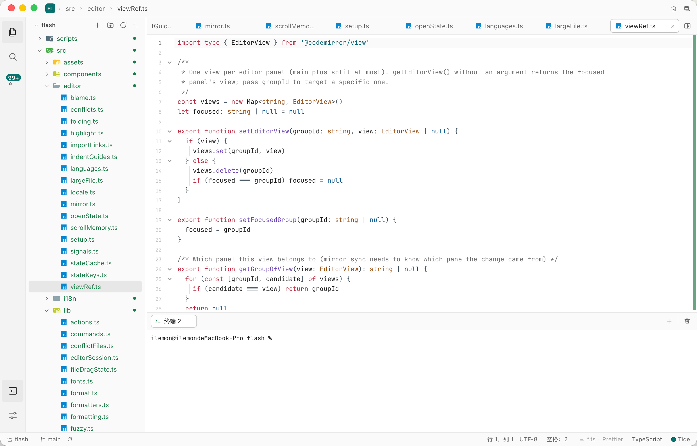

<p align="center">
  
</p>

<h1 align="center">Tide</h1>

<p align="center">
  A lightweight code editor built with Rust and inspired by VS Code — a lighter VS Code alternative.
</p>

<p align="center">
  <a href="README.zh-CN.md">简体中文</a> | English
</p>

<p align="center">
  <a href="https://github.com/ilemon18/tide/releases">Download</a>
</p>

<p align="center">
  
</p>

## Install

On macOS, download the `.dmg` from [GitHub Releases](https://github.com/ilemon18/tide/releases/latest), open it, and drag **Tide** onto **Applications**. After copying finishes, open Tide from Applications and eject the mounted disk.

Or install from the command line:

```sh
curl -fsSL https://github.com/ilemon18/tide/releases/latest/download/install.sh | sh
```

Windows users: download the `.exe` from [GitHub Releases](https://github.com/ilemon18/tide/releases/latest).

## Why Tide?

Tide is a focused, AI-native editor for people who want a fast, lightweight workspace without giving up familiar editing conventions. It is designed as a lighter alternative for everyday coding, not as a complete replacement for the full VS Code ecosystem.

Performance and resource use vary with the project, settings, installed tools, and running services. This comparison describes product focus rather than benchmark results.

## Features

- **AI pair programming**: Local AI coding agents in dedicated tabs.
- **Fast by design**: On-demand indexing and bounded caches.
- **Familiar editing**: VS Code shortcuts, command palette, split view, and find & replace.
- **Integrated workflow**: Git, global search, outline, and a multi-tab terminal.
- **Personalized workspace**: Session restore, 21 themes, and six languages.
