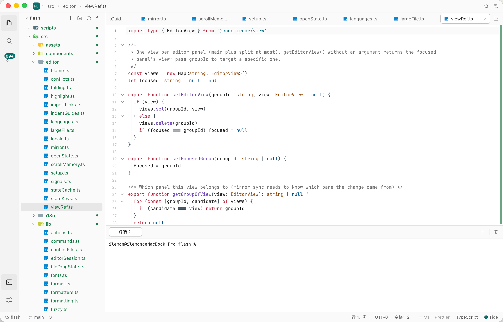

  

<h1 align="center">Tide</h1>

  受 VSCode 启发，用 Rust 打造的轻量代码编辑器，一个更轻的 VSCode 替代品。

  <a href="README.md">English</a> | 简体中文

  <a href="https://github.com/ilemon18/tide/releases">下载</a>

  

## 特性

- **轻量省内存**：基于 Tauri，不打包 Chromium，精简 VSCode 大部分不常用功能，按需释放标签与缓存。
- **熟悉的体验**：沿用 VSCode 快捷键，支持命令面板、多标签、分屏和查找替换。
- **结构大纲**：侧栏按文件展示符号树，快速打开里输入 `@` 直接跳转。
- **内置 Git**：暂存、提交、推拉、差异对比、行内 blame 与冲突解决。
- **原生终端**：多标签 PTY，自动定位当前文件目录。
- **全局搜索**：遵循 .gitignore，支持正则、路径筛选与批量替换。
- **按需格式化**：默认关闭，启用后按文件类型匹配格式化工具。
- **会话恢复**：恢复项目、文件与光标位置，支持多窗口。
- **21 套主题**：内置主流配色，支持跟随系统。
- **六种语言**：简中、繁中、英、日、韩、西，即时切换。
